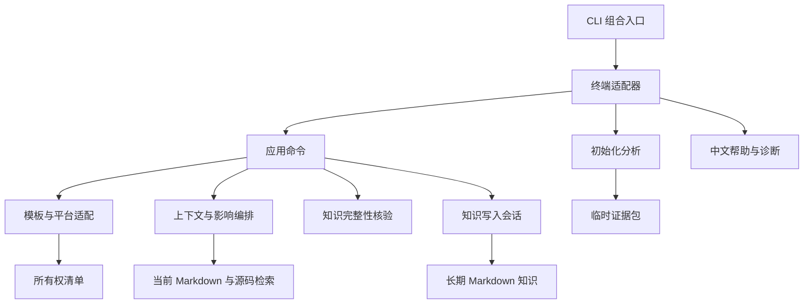

# 架构设计

Modus 将三个生命周期分开管理：**接入资产让工作流可用，初始化分析提供可丢弃的证据，经过评审的 Markdown 保存长期知识**。日常检索读取当前源码与知识正文，不重建或重开初始化数据。模块围绕各自拥有的数据、失败语义与变更边界划分。

<!--
阅读入口按职责排列；新增入口时核对真实的模块所有者。
-->

## 从这里开始阅读

1. [CLI 组合入口](src/modus/cli.py)：五个公开命令与供技能调用的内部适配器。
2. [项目安装](src/modus/commands/init_project.py)：预检、计划写入、回滚与清单发布。
3. [分析 API](src/modus/machine/api.py)：构建、验证后打开、证据筛选与创作上下文。
4. [上下文解析](src/modus/orchestrator/context_resolver.py)：一个请求、一个共享预算、一份当前证据。
5. [知识更新](src/modus/knowledge_update.py)与[写入会话](src/modus/knowledge_write_session.py)：所有权、读取时哈希、并发冲突与原子发布。

<!--
依赖方向与写入所有权同时约束扩展，不能仅凭导入无环判断分层。
-->

## 依赖与所有权



| 边界 | 所有者 | 扩展规则 |
| --- | --- | --- |
| 命令树与全局参数 | `cli.py` | 显式注册公开入口，不承载工作流实现 |
| 参数、交互、流与退出码 | `cli_commands/` | 按工作流拆分适配器，不修改 Click 全局状态 |
| 中文帮助与解析错误 | `cli_commands/presentation.py` | 从已注册参数生成帮助，仅适配框架固定句式 |
| 分析进度与恢复提示 | `cli_commands/analysis_display.py` | 转换展示副本，不改证据、摘要或 JSON 契约 |
| 协议值的展示名称 | `display_labels.py` | 终端与 Markdown 复用；未知值保留原标识 |
| 安装与维护事务 | `commands/` | 返回结构化结果，展示由 `*_report.py` 负责 |
| 平台中立的工作流分发 | `scaffold/` | 验证静态模板并记录资产所有权 |
| 宿主差异 | `platforms/`、`hooks/` | 声明布局，复用合并与卸载契约；`platforms/display.py` 统一平台显示名与交互顺序 |
| 初始化分析 | `machine/` | 单向语义阶段，显式覆盖缺口 |
| 任务编排 | `orchestrator/` | 组合证据与策略，不拥有搜索算法或写入 |
| 检索 | `retrieval/` | 共享截止时间与输出预算，明确返回部分结果 |
| 完整性 | `knowledge_verification/` | 报告客观缺陷，不给正文质量打分 |
| 长期写入 | `knowledge_write_session.py` | 路径约束、所有权、哈希条件写入、锁与原子替换 |

<!--
机器层的确定性不等于业务结论的完整性，二者各有验收责任。
-->

## 分析证据是创作输入

```text
N1 源码基线 → N2 程序事实 → N3 关系解析 → N4 能力模型 → N5 创作投影 → N6 证据包
```

后续阶段消费前序契约。投影与打包不能重新读取源码来补造缺失观察。存储与资源策略不依赖任何语义阶段。[架构测试](tests/machine/test_architecture.py)检查这些方向，包括函数内的延迟导入。

可选解析器或编译器缺失，只产生对应范围的覆盖回执。契约、完整性、输入漂移或必需工具失败会中止本轮。完整证据包经过核验后才原子发布；失败不能替换已有完整包，也不能把旧包当作当前证据。消费者必须提供本轮身份，并使用经过认证且有预算限制的查询。

[分析层指南](src/modus/machine/README.md)说明扩展注册、进度、摘要与错误码。编译器观察属于 N2；语言适配器无权决定最终业务边界。

同一阶段内部继续按责任分解：

| 职责 | 组合入口 | 支撑模块 |
| --- | --- | --- |
| 原子发布 | [产物 I/O](src/modus/artifacts_io.py) | [原子写入](src/modus/atomic_writes.py)负责描述符绑定与替换；锁与 YAML 加载留在产物 I/O |
| 文件内解析 | [原生解析器](src/modus/machine/facts/native_parser.py) | [语法契约](src/modus/machine/facts/native_syntax.py)定义语法类别与可移植结果；[访问器](src/modus/machine/facts/native_visitor.py)负责单文件遍历，入口负责解析器选择与生命周期 |
| 框架观察 | [前端入口](src/modus/machine/facts/frontend.py) | [上下文](src/modus/machine/facts/frontend_context.py)、[状态](src/modus/machine/facts/frontend_state.py)与[服务路由](src/modus/machine/facts/frontend_server.py)共享源码锚点，不执行应用 |
| 拓扑 | [拓扑组装](src/modus/machine/resolution/topology.py) | [规则](src/modus/machine/resolution/topology_rules.py)、[记录](src/modus/machine/resolution/topology_records.py)与[资源](src/modus/machine/resolution/topology_resources.py)分开处理分类和发布 |
| 目录投影 | [证据目录](src/modus/machine/store/bundle_catalogs.py) | [范围目录](src/modus/machine/store/scope_catalog.py)拥有范围记录，[构建原语](src/modus/machine/store/catalog_building.py)共享规范化操作 |
| 工作区地图 | [工作区服务](src/modus/workspace.py) | [地图渲染](src/modus/workspace_maps.py)只消费观察，不读写成员仓库 |

移动解析实现时必须同步实现指纹。观察结果的缓存身份要随访问器或语法契约变化而失效，仅以源码内容作为缓存键不够。

<!--
人工正文的所有权与分析缓存不同，重建证据不得覆盖人工知识。
-->

## 长期知识有独立的生命周期

| 接入项目中的位置 | 生命周期与权限 |
| --- | --- |
| `.modus/` 与平台接入文件 | 框架受管资产，由清单保护用户修改 |
| `modus/.cache/` | 可丢弃的分析与临时创作状态 |
| `modus/knowledge/` | 经评审、随项目版本管理的 Markdown |
| 知识中的 `business/` 与 `constraint/` | 默认由人工维护，自动化修改需要明确授权 |

[创作契约](docs/authoring-contract.md)区分证据闭环、面向读者的正文与发布。机器建议指导调查，当前源码、测试、配置与明确材料确立事实。结构核验 `clean` 不等于业务事实正确或正文清晰。

写入使用准备修改时观察到的哈希。并发修改形成冲突，不被覆盖。迁移先建立新主定义、修复链接，再删除旧生成文件。知识更新批次按文件报告独立结果，不承诺全批回滚；安装事务则对计划目标创建快照，失败时尝试精确回滚，并明确报告恢复不完整。

安全文件读取与知识退役按平台选择后端：POSIX 使用目录描述符与相对操作；Windows 核验所有父目录的身份快照、常规文件身份与原始字节摘要，并拒绝软链和重解析点。Windows 删除前关闭读取句柄，再复核目标；路径快照能发现观察到的替换，但不提供抵御外部进程在两次检查间交换并恢复目录的绝对保证。知识写入和退役仍共享必需文档锁，分别使用 POSIX `flock` 或 Windows `msvcrt`。受管文件显式按 UTF-8 原样写入换行，确保清单摘要与磁盘字节一致。

<!--
日常读取使用当前项目内容，初始化数据不是长期检索索引。
-->

## 检索始终面向当前项目

[编排层](src/modus/orchestrator/README.md)选择范围并组装协议；[检索管线](src/modus/retrieval/README.md)负责渐进发现 Markdown、词法与结构排序、源码采集和交付。整个请求共用一个预算，缺失证据、不安全文件与截断都可见。运行时不能用初始化缓存替代当前源码。

仅在执行分析命令时导入分析依赖。帮助、状态、安装和普通源码/Markdown 检索不提前加载解析器、图依赖或分析管线。

<!--
展示语言可本地化，稳定命令、字段和错误码仍保持机器兼容。
-->

## 中文体验与公开契约

面向用户的帮助、交互、诊断、生成知识和维护文档默认使用简体中文。命令名、参数、路径、Python 标识、JSON 字段、状态值与稳定错误码保持协议原样。用户明确指定其他正文语言时，创作工作流遵从该要求。

中文化在拥有文本的边界完成：命令目录维护语义说明，报告模块维护结果展示，终端层适配框架默认提示，模板维护创作约定。错误信息说明问题与恢复动作，第三方工具的原始诊断可作为细节保留。不得通过全局猴子补丁、整段输出替换或改写传输字段实现本地化。

增加宿主时扩展经过验证的平台注册表；增加语言时同步声明、版本化实现与支持/降级夹具；增加检索信号时修改其所属阶段。不要仅为缩短文件创建抽象，只有所有者、生命周期或失败策略不同才拆分。

[贡献指南](CONTRIBUTING.md)说明命名、注释与验证要求。[发布工具](scripts/README.md)检查源码包和 wheel，并脱离源码仓库运行已安装产物。
