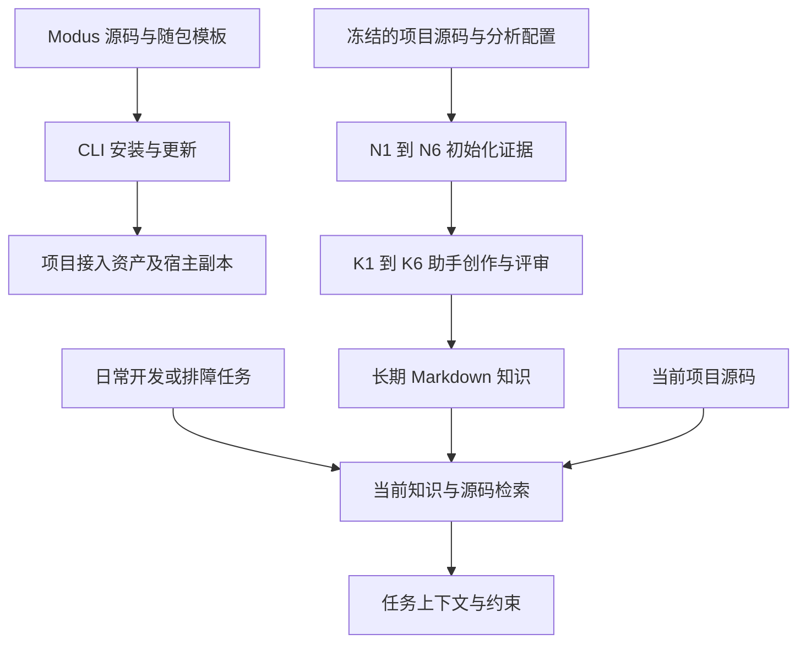

# 全局项目概览

阅读目标：先理解 Modus 服务谁、交付什么，以及一个改动该落在哪个所有者。本文中的源码路径相对于当前 Modus 仓库根，不能与接入后的业务项目目录混淆。

## 产品定位与三条生命周期

Modus 为编程助手提供有证据支撑、可维护的项目知识。Python CLI 安装平台资产、分析初始化输入、检索当前知识和源码、保护知识写入；语义正文由助手依据模板工作流创作。



三条生命周期的完成含义不同：安装以受管清单发布为提交标记；分析以认证证据包原子发布为完成；知识需要语义回读、机械核验与写入保护。日常检索不重新打开初始化包。

## 仓库地图

| 源码位置 | 责任与主要入口 |
| --- | --- |
| `pyproject.toml`、`uv.lock`、`src/modus/__init__.py` | `openmodus` 包、依赖锁、版本；终端入口 `modus = modus.cli:main` |
| `cli.py`、`cli_commands/`、`command_reference.py`、`surface.py` | 命令树、参数/交互/退出码、帮助元数据、五个内置技能的调用类别 |
| `commands/` | 安装、更新、卸载、个人包维护、状态与核验等应用服务；`*_report.py` 负责展示 |
| `scaffold/`、`scaffold/templates/` | 模板目录、受管写入、中立接入资产；模板定义助手行为与知识种子 |
| `platforms/`、`hooks/` | 四种宿主的布局投影、共享区块/钩子合并、启动事件与最小指引 |
| `machine/` | 初始化分析的 N1–N6、资源策略、不可变证据存储与有界查询 |
| `orchestrator/`、`retrieval/` | 当前源码与知识的路由、搜索、共享预算、影响候选与上下文交付 |
| `knowledge_update.py`、`knowledge_write_session.py` | 显式材料更新、哈希条件写入、生成文档精确退役 |
| `knowledge_verification/`、`commands/verify_*.py` | Markdown、链接、身份、锚点、敏感字面量与发布承诺检查 |
| `workspace.py`、`workspace_maps.py` | 多仓成员只读观察、成员路由、工作区自己的导航投影 |
| `schemas/`、`schema_resources.py`、`scope_models.py` | 传输协议、Domain/Module 稳定身份、源码锚点 |
| `tests/`、`scripts/release_smoke/`、`.github/workflows/ci.yml` | 契约测试、跨平台计划、独立安装产物验收 |
| `ARCHITECTURE.md`、`CONTRIBUTING.md`、`docs/` | 分层、开发规范、N/K 交接和创作设计主定义 |

基础支撑：`config.py`（配置验证）、`paths.py`（规范路径）、`manifest.py`（资产所有权）、`artifacts_io.py`（锁与加载）、`atomic_writes.py`（描述符绑定发布）、`knowledge_reader.py`（安全读取）、`knowledge_identity.py` / `scope_resolver.py`（正式知识身份）、`skillmd.py`（有界 frontmatter）、`sensitive_literals.py`（泄漏检测）、`git_hygiene.py`（Git 索引保护）、`source_listing.py`（普通导航盘点）。新增工具逻辑优先查这些已有所有者。

## 当前公开面

| 调用位置 | 已有入口 | 实现依据 |
| --- | --- | --- |
| 终端公开命令 | `init`、`update`、`help`、`uninstall`、`status` | `cli.py` |
| 助手显式工作流 | `/modus-init`、`/modus-reinit`、`/modus-update-knowledge` | `surface.py` 与三个同名模板 |
| 自动知识能力 | `using-modus`、`modus-sync-knowledge` | `surface.py`；update-knowledge 同时支持意图路由 |
| 内部适配器 | `internal init-analysis build/select/context`、`context resolve`、`knowledge ...` | `cli_commands/analysis.py`、`context.py`、`knowledge.py` |
| 内置宿主 | `claude`、`codebuddy`、`codex`、`cursor` | `platforms/registry.py` |

内部入口可调用，但不显示为普通用户命令。不能沿用旧版 `auto/vibe/plan/spec/harness` 作为当前公开命令。斜杠别名以 `command_reference.py` 为准，主名称使用连字符。

## 接入后项目的目录

```text
<用户项目>/
├── .modus/                      接入控制面
│   ├── config.yaml
│   ├── manifest.json
│   ├── commands/、skills/       平台中立工作流权威源
│   └── hooks/                   启动器
└── modus/
    ├── .cache/                  可重建证据、临时执行卡及锁
    └── knowledge/
        ├── architecture-overview.md
        ├── constraint/          global-standard.md、team-standard.md
        └── domain/<domain>/
            ├── SKILL.md         领域路由
            └── references/
                ├── modules/<module>.md
                ├── api.md、object.md、rule.md
                ├── state_machine.md、downstream.md、infrastructure.md
                └── business/    人工 meta、experience、scenario
```

工作区另外使用 `knowledge/handbook/SKILL.md` 与 `references/generated/` 保存外层导航。实际路径由 `ModusPaths`、`KnowledgePathIdentity` 决定。

iwiki 的 `modus/artifacts/<story-id>` 是交付过程区的设计描述；当前 `ModusPaths` 不拥有这一需求交付引擎。仓库原有未跟踪 `artifacts/`、`docs/output/` 是历史材料，不能直接证明本分支功能。

机器链：`corpus.freeze → facts.observe → resolution.resolve → capability.compose → projection.project → packet.package`。后段消费前段产物；`store/runtime` 是横切支撑；`pipeline.py` 只编排。

创作链：K1 范围决策 → K2 主定义与创作计划 → K3 场景证据闭环 → K4 领域成稿 → K5 跨域组装 → K6 核验与发布。这条链由助手模板协议执行，不能描述为 Python 已全自动生成业务正文。

设计主定义为 `ARCHITECTURE.md`、`src/modus/machine/ARCHITECTURE.md`、`docs/knowledge-lifecycle-boundary.md`、`docs/authoring-contract.md`；具体机制以当前实现及测试核对。
