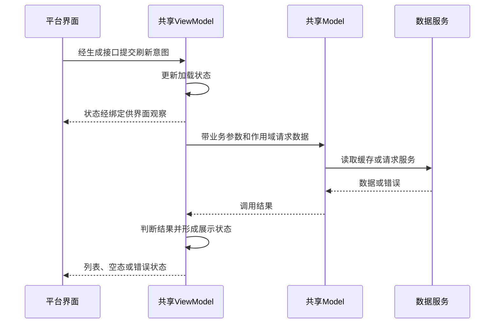

# 理解 DTMP：共享逻辑、平台实现与生成绑定

仅在目标项目使用 DTMP 时读取。先用前四节建立架构认识，再按后面的路径调查具体功能；不需要为每个问题重读整套框架。本文是取证适配指南，不是自动语义解析器，也不改变通用四专题或模块身份。

文中的职责来自框架设计，机制说明用于定位当前实现。调查时分别记录设计约束、材料当时的实现和目标版本的源码事实；线上命中还需运行证据。旧文档中的 TODO、推荐写法、平台覆盖不能直接当成当前事实。

## 1. DTMP 共享的是逻辑，不是整套界面

DTMP 保留各平台的界面和系统能力，把可复用的业务逻辑放在共享层。理解一个功能时，先区分四种角色：平台负责交互和能力执行，ViewModel 整理展示状态，Model 协调可复用业务，Service 管理数据和 I/O。生成绑定负责让这些角色能跨语言对话，不另做一份业务实现。

| 角色 | 为什么存在、主要责任 | 容易误读的地方 |
| --- | --- | --- |
| View／平台适配 | 显示状态、接收用户动作，提供页面生命周期、权限和系统/SDK能力 | 平台代码可能还保留业务分支；不能预先假定它只渲染 |
| ViewModel | 面向页面或独立组件，接收输入，把业务结果变成可观察的展示状态 | 不机械等同于 Activity/Fragment；生成的同名门面不是第二个业务 ViewModel |
| Model／BizModel | 组合 Service，封装可复用的非展示逻辑和调用生命周期，也可持有多个组件共享的临时状态 | 不是 DTO；TypeModel 是类型化调用机制，不是必须再经过的一层业务模块 |
| Service | 管理业务数据、网络、本地存储及耗时能力；BizService、CoreService 是不同职责的服务 | BizService 属于 Service 层，不是它之后还必须再调用一个“Service” |
| 生成绑定 | 将 IDL 契约投影为类型化入口、参数转换、分派和观察接口 | 带业务名字也可能只是样板；生成物数量不等于业务模块数量 |

分层隔离的是平台差异、展示生命周期、共享编排和数据/I/O责任，不是要求所有功能调用都穿过所有层。纯选择操作可能只更新 ViewModel 状态；无界面的调用方也可能直接使用 Model 契约。

如果遇到 LogicView，先读它的实现。它可能只是承载订阅、参数转换、block/delegate 的隐藏适配 View，并非 DTMP 强制存在的业务层。平台持有列表等数据也不必然是第二份业务真源：要判断它是展示投影，还是能够独立决定业务结果的状态。

## 2. 三条调用路径，不要画成一条直线

| 路径 | 输入与结果怎样流转 | 要区分什么 |
| --- | --- | --- |
| 界面状态链 | View → 生成 ViewModel API → 手写 ViewModel；需要业务能力时再调用 Model/Service；结果经 State 回到 View | 输入 Action 与展示 State 方向相反；点击不一定触发网络 |
| 共享模型调用 | 无 View 的调用方 → Model Provider/类型化门面 → 共享实现；返回结果或通过 State/Event通知 | 不为这条路径硬造 ViewModel；Model 生命周期不等于调用页面生命周期 |
| 平台能力调用 | 共享调用方 → PlatformChannel 生成桥接 → 平台能力实现 → 结果回传 | 方向是共享层请求平台；通道不是 BizModel 下一级，也不应替代业务 Service |

PlatformChannel 适合需要平台上下文的通用能力。依赖页面的操作要使用对应 ViewContext，而非任意全局窗口；参数怎么转、能力由谁注册、所有终止分支怎样回传，仍需读具体实现。框架有通道不代表存量页面的导航或提示都已走通道。

例如“刷新列表”可以这样理解（职责示意，不是某个模块的既成调用链）：



这里生成接口没有请求数据，界面也没有收到 ViewModel Action 的业务返回值。若实际业务还广播 Model Event，应另说明谁订阅、为何更新，不能从示意图补造事件或服务调用。

## 3. Action、State、Event：先看所属对象，再解释语义

| 机制 | 应怎样理解 | 调查时的关键区别 |
| --- | --- | --- |
| ViewModel Action | View 提交输入意图；这一边界不提供同步或异步业务返回值，通常以 State 表达后续可见结果 | `Handle` 返回 void；分派钩子的 bool 表示动作是否被处理，不是操作成功 |
| Model Action | 调用一项共享业务能力，可以同步返回类型化 Result | 不把 ViewModel 的“无返回值”约束套到 Model；检查 Result 内真正的业务状态 |
| Model AsyncAction／通道异步调用 | 一次有结果和取消边界的调用，可通过回调或 job 交付 | Async 不等于自动后台线程，也不保证一定延迟完成；旧门面的 bool 可能只代表受理 |
| State | 有当前值的可观察状态，适合重新绑定后重建展示；ViewModel 和 Model 都可以提供 | 检查初值、写入者、观察者及映射；展示值和服务权威数据不是同一层 |
| Event | 一次发生通知，适合模型间协作；不是可查询的最新快照 | 通用事件分发不保存最新值供后来订阅者回放；不能替代初始查询或 State |

C++ State 的观察注册会交付当前值，更新也可能在当前调用栈同步通知，不能假设回调总在下一帧。Model Event 同样可能同步分发，但事件通知仍不是调用的返回值。平台 reactive property、StateFlow 或其他适配可能改变消费调度、相等去重和中间值可见性；不能把一种平台机制的行为套到所有绑定。

尤其要识别“用 State 发一次性信号”：如果实现先写有效值再立即清空，应如实说明这是 State 脉冲用法，而不是因注释叫“事件”就写成 IDL Event。某端同步观察能接到，不证明其他端的异步收集不会合并中间值；也不应把它直接推广成新功能的推荐方案。

框架设计要求 ViewModel/Model 及其相关回调遵守主线程约束，耗时工作交给 Service。线程检查不是自动切线程；要沿实际回调核对返回线程。取消令牌存在也不证明底层请求已停止。始终区分：调用受理、异步返回、业务成功、界面呈现以及外部副作用完成。

## 4. 从声明找到实现：生成关系与运行关系分开查

IDL 是接口来源，不是运行时参与者。典型生成关系如下，具体文件形态以项目版本为准：

```text
IDL 声明
  ├─ 生成共享 Stub：参数/结果类型、分派入口、状态定义
  │     └─ 手写 Impl：继承 Stub，实现业务处理钩子
  └─ 生成平台门面：包装输入、调用共享对象、提供状态/事件消费接口
```

要证明平台调用到了手写实现，需要继续核对：类型标识 → 实现注册/工厂 → Provider 创建或取得对象 → 门面包装同一对象 → 动作分派。名称相似、注册宏存在、生成文件存在，都不足以证明目标构建实际纳入或运行时取得成功。

| 定位目标 | 查到什么才算把关系接上 |
| --- | --- |
| 契约来源 | IDL 类型、导出平台、动作/状态/事件及生成标记；接口变更回到 IDL，不手改生成编号或分派表 |
| 手写逻辑 | 生成 Stub 的处理钩子由哪个 Impl 实现；业务条件、数据写入和失败策略在谁的方法体中 |
| 装配与持有 | 注册类型与生成 API 类型一致，目标构建包含注册实现，Provider/工厂和平台持有者确实相连 |
| 输入与回流 | 平台调用经门面分派到处理函数，再找到状态写入、结果回调或事件订阅的真实消费者 |

共享 Model 通常由应用 Runtime 的 Provider 按类型取得并复用，VM 则由 ViewModel Provider 创建并交由宿主绑定。常见检索入口是 `REGISTER_TYPE_MODEL`、`AppTypeModelOf`、`REGISTER_VIEW_MODEL` 和 `CreateViewModel`，它们是定位词，不是所有项目都必须同名的规范。

Model 的初始化还关系到可见性：Provider 先构造并 Init，再放入实例表，随后 DidInit。跨 Model 协作应在初始化后阶段进行，避免 OnInitialize 中互相获取造成递归初始化。不要把 ModelProvider、ModuleRuntime、ViewContext 或含糊的“ModelContext”混称为一个依赖注入容器。

### 各端常见入口与证据边界

- **iOS**：OC++ 可以通过 `dtmp_Bind` 关联共享 VM，在 `dtmp_dataBind` 观察状态，直接调用生成的 C++ typed 门面；另有 Objective-C/Variant 门面。不能假定每个功能都经过同一种 `performAction` 或 reactive wrapper。绑定包含对象创建、ViewContext 装配和观察时机，UI 初始化顺序及重复绑定保护都要核对。
- **Android/KMP**：从 common 契约、目标 sourceSet 的 actual、native 桥接查到对应 C++ 对象；Kotlin 声明可能是 IDL 产物，不代表业务改为 Kotlin 共享实现。继续看 `WithViewModel` 等绑定入口、StateFlow 收集和传统 View/Compose 的释放策略，不以 common/actual 同名证明链路完整。
- **Swift或ArkTS**：先确认实际生成入口、桥接、注册和调用方。仅有 Swift 条件编译或鸿蒙方案文档，不足以宣称已有该功能的运行链；缺证保留为待核验，不类推 iOS/Android 接法。

原生逻辑按责任分清：平台 UI/系统能力、跨语言转换适配、仍在原生的业务判定或兼容分支。后两类都要继续读条件、数据和回流，不能止于“交给宿主”。但存在原生逻辑不自动等于架构违规，也不授权产卡时顺手下沉或重构。

## 5. 三种“绑定结束”不等价

| 生命周期 | 对应含义 | 不能推导的结论 |
| --- | --- | --- |
| 框架创建/绑定 | 为 View 取得 VM、装配 ViewContext 并安装状态观察 | 不等于已经绑定某个消息/会话或加载完业务数据 |
| 业务 Bind/Unbind | IDL Action 让实例服务某个对象或结束该关联，由业务实现决定清理 | 名称叫 Unbind 不证明取消请求，更不等于 VM Dispose |
| Attach/Detach | 宿主附着状态改变，可能仍等待复用 | Detach 不自动取消 VM scope，不能当成析构 |
| Dispose/反初始化 | VM Dispose 收口其 scope；Model 的 scope 跟随自己的反初始化 | 长命 Model、Service 或独立保存任务不因一个 View 离开就必然结束 |

VM 的 Create、Attach、Detach、Dispose 与业务 Action 是两套机制。核对框架默认清理，也要核对业务钩子中的额外行为；不要用方法名或注释证明释放已发生。

实例被复用时，旧消息/账号的任务可能需要比 VM 更短的业务 scope，并在回包时校验身份或代际。AsyncScope 只管理登记其中的任务和订阅；取消可能不走普通结果回调，必须检查清理是否依赖一个永远不会到来的回调。ViewContext 失效后也不能继续发起页面能力调用。

## 6. 用实际问题检验是否真的读懂

| 问题 | 足够的回答应包含 |
| --- | --- |
| 功能在哪里实现？ | 契约来源、手写共享处理、仍在平台的判断和最终结果；不只列类名 |
| 改接口会影响哪里？ | IDL、生成绑定、Impl、注册装配及实际平台消费者；未验证端单列，不按后缀猜覆盖 |
| 为什么数据变了界面没变？ | 权威数据到展示 State 的转换、观察安装时机、业务身份、收集生命周期和适配语义 |
| 为什么离页后还收到结果？ | 业务解绑、附着状态、Dispose、实际 scope 与下游取消是否一致，以及迟到回调校验 |
| 怎样扩展或复用？ | 当前可用的接入点与条件、共享责任、原生例外、必须保持的协议和回归入口 |

如果旧材料写某设施“仍在设计中”，当前源码却已有相关方法，应核对该版本的装配与使用，而不是照抄 TODO 或反过来宣称全部接入完成。文档说 Unbind 取消任务而方法体只清字段时，以方法体解释现状，并把设计要求另列。

调查结果进入现有四专题：接口与数据记录真实契约及映射；协作与影响记录分派、调用和消费关系；规则与配置记录组合条件和生效分支；生命周期记录状态、作用域、资源与观测。模块手册用业务语言把一次任务讲完整，不复制整份框架教程。框架机制、具体业务和文档父子目录是三种不同关系，不能据目录归属画运行调用图。

新增参考材料只用于理解和定向回源；不要把内部链接、真实配置键、账号、业务源码或机器路径复制到通用指南。保留可迁移的机制和框架定位词，具体业务证据留在其已授权的知识范围。
